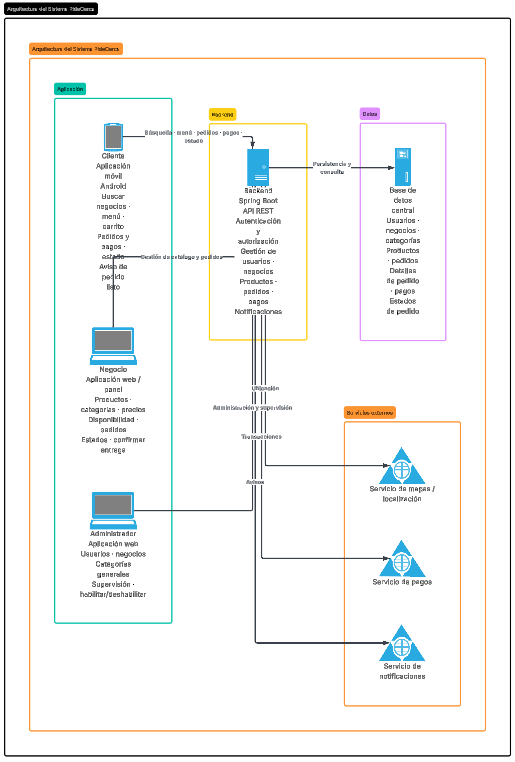

# Arquitectura del Sistema PideCerca

## 1. Descripción

PideCerca utiliza una arquitectura en la que las aplicaciones de los usuarios se comunican con un backend central, encargado de procesar la información, aplicar la lógica del sistema y conectarse con la base de datos.

## 2. Componentes del sistema

### Aplicación Android
Utilizada por los clientes para buscar negocios, consultar productos, realizar pedidos, efectuar pagos y consultar el estado de sus pedidos.

**Tecnologías:**
- Android
- Kotlin
- Jetpack Compose

### Aplicación Web del Negocio
Utilizada por los dueños de los puestos para recibir y preparar pedidos, administrar su menú y consultar su historial. Está pensada para usarse desde el celular.

**Tecnologías:**
- React
- Vite
- JavaScript
- CSS

### Panel Web del Administrador
Utilizado por el administrador para gestionar usuarios, negocios y categorías generales, y para supervisar los pedidos de la plataforma.

**Tecnologías:**
- Django
- HTML
- CSS
- JavaScript

### Backend
Encargado de procesar las solicitudes, aplicar la lógica del sistema y proporcionar la API REST.

**Tecnologías:**
- Java
- Spring Boot
- Spring Security con JWT
- API REST

### Base de Datos
Encargada de almacenar la información del sistema.

**Datos principales:**
- Usuarios
- Negocios
- Categorías
- Productos
- Pedidos
- Detalles de pedidos
- Pagos
- Notificaciones

### Servicios externos
Servicios que complementan el funcionamiento del sistema.

- Mapas y ubicación
- Pagos
- Notificaciones

## 3. Comunicación entre componentes

La comunicación principal del sistema seguirá el siguiente flujo:

**Aplicación Android / Web del Negocio (React) / Panel Admin (Django) → API REST → Backend Spring Boot → Base de Datos**

El Backend será el encargado de recibir las solicitudes, procesarlas y devolver la información correspondiente.

- La aplicación Android y la web React llaman directamente a la API REST desde el dispositivo del usuario.
- El panel Django llama a la API REST desde su servidor y guarda el token JWT del administrador en la sesión.
- Todas las aplicaciones se autentican con un token JWT que el backend entrega al iniciar sesión. El backend controla los permisos según el rol: CLIENTE, NEGOCIO o ADMIN.

## 4. Herramientas utilizadas

- **Lucidchart:** elaboración de diagramas de arquitectura y diseño.
- **Android Studio:** desarrollo de la aplicación Android.
- **IntelliJ IDEA:** desarrollo del Backend con Java y Spring Boot.
- **Visual Studio Code:** desarrollo de la aplicación Web y documentación.
- **Git:** control de versiones.
- **GitHub:** almacenamiento y gestión del código fuente.

## 5. Diagrama de arquitectura

El siguiente diagrama representa la arquitectura general del sistema PideCerca:

## 6. Resumen de la arquitectura

PideCerca estará compuesto por una aplicación móvil para los clientes, una aplicación web en React para los negocios, un panel web en Django para el administrador, un Backend desarrollado con Spring Boot y una base de datos central.

Las aplicaciones se comunicarán con el Backend mediante una API REST. El Backend procesará las solicitudes y administrará la comunicación con la base de datos y los servicios externos.

